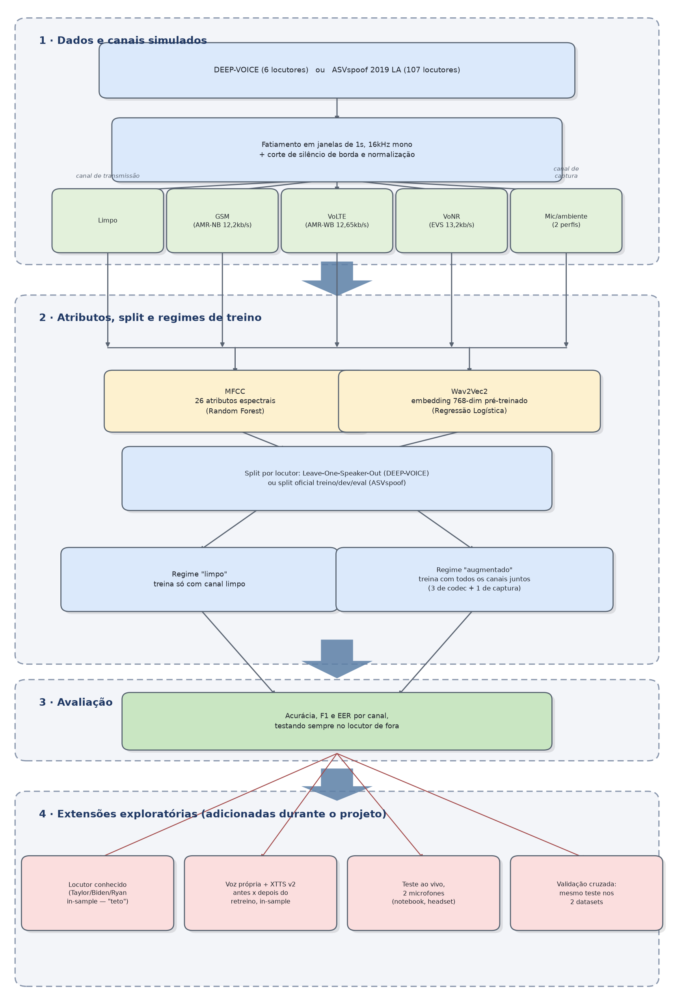
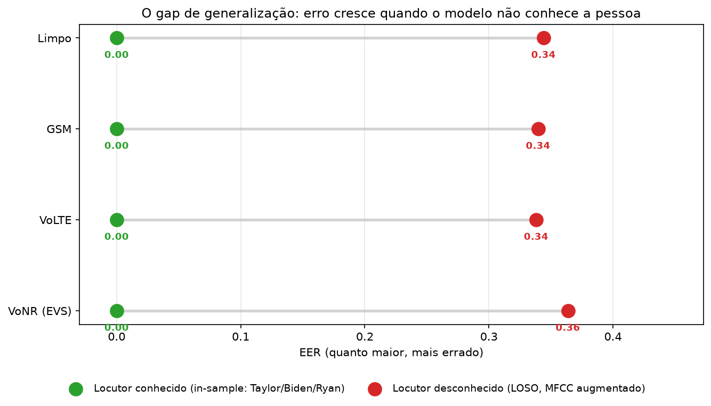
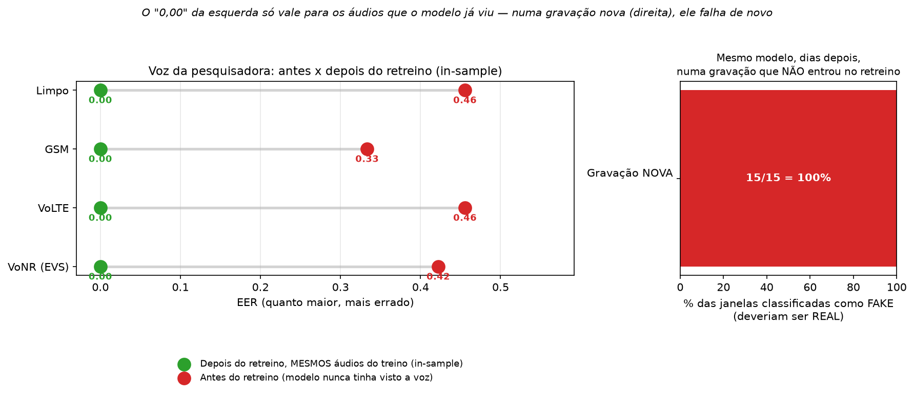
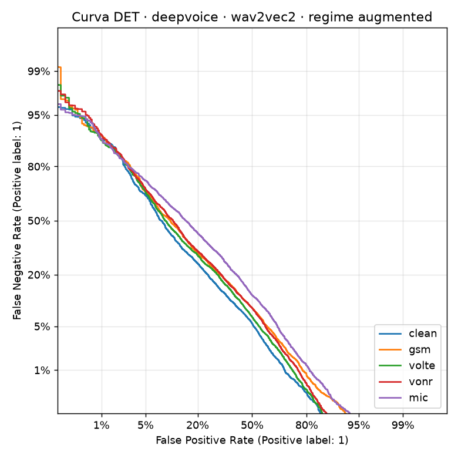
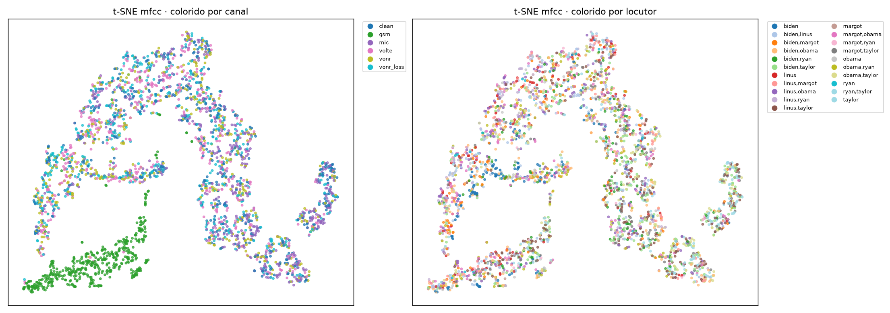
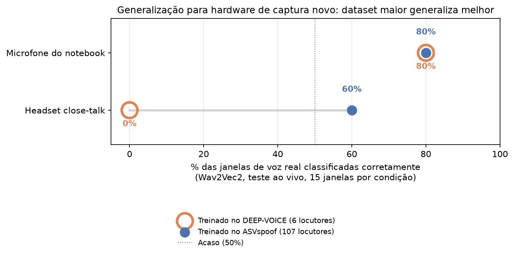
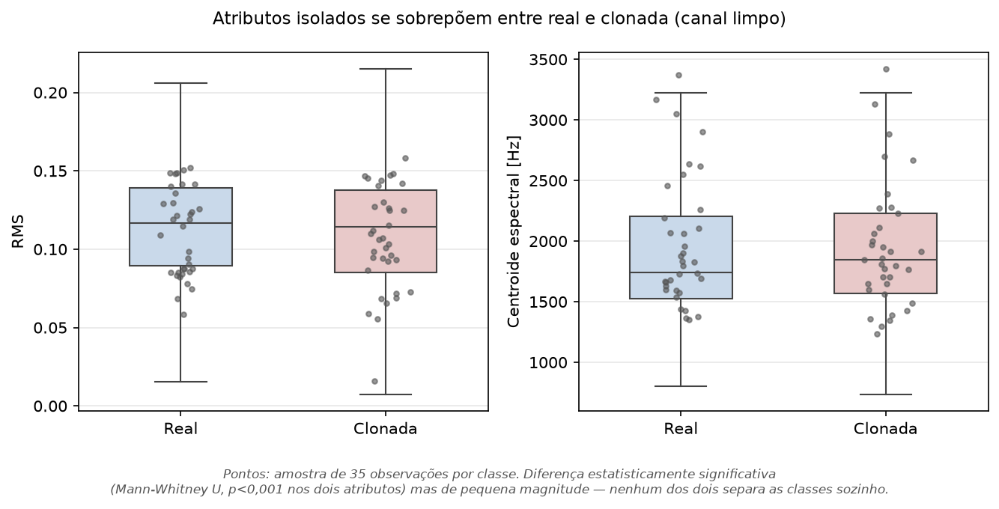

# ANTI-FAKE-VOICE: Detecção de Deepfakes de Voz em Streaming na Borda (MEC) e Robustez ao Codec 5G (VoNR/EVS)

Projeto de pesquisa acadêmica que investiga uma pergunta simples: **um classificador
de voz clonada erra mais quando o áudio passa por um codec de telecom (GSM, VoLTE,
VoNR/5G-EVS) — do mesmo jeito que ouvintes humanos erram mais, segundo um artigo de
referência** — e se **Data Augmentation** (treinar o modelo já expondo-o a esses canais
distorcidos) resolve essa queda de desempenho. Tudo isso sob a restrição de latência
de um nó MEC (Multi-access Edge Computing): o classificador precisa decidir mais rápido
do que a duração da própria janela de áudio, para caber num cenário de detecção em
tempo real numa ligação.

Achado central do projeto: a compressão por codec de fato prejudica o classificador
"limpo" (mais no VoNR do que nos outros dois, confirmando a hipótese do artigo de
referência), e Data Augmentation resolve isso — mas o modelo continua falhando ao ser
testado numa voz, microfone ou ambiente que nunca apareceu no treino, mesmo depois de
retreinado com uma única sessão de gravação extra. Essa segunda parte (generalização
para pessoas/gravações novas) é um problema diferente do problema do canal, e ficou
documentada como achado, não escondida. Os detalhes de cada etapa, com os números,
estão nas tabelas de `results/` e no relatório técnico completo (gerado durante o
desenvolvimento, fora deste repositório).

O projeto foi validado num segundo dataset bem maior, o **ASVspoof 2019 LA** (107
locutores, 19 tipos de ataque de síntese, split oficial treino/validação/teste com
ataques nunca vistos no teste) — o mesmo padrão de resultado se confirmou lá. Também
foi adicionado um 5º canal simulando **microfone/ambiente de captação** (não só codec
de telecom): ele ajuda o classificador pesado (Wav2Vec2) a generalizar melhor para
microfones nunca vistos no treino, mas a simulação sozinha não bastou para um headset
sem fio — duas tentativas de recalibrar o perfil de microfone não resolveram. O que
resolveu (parcialmente) não foi mexer na simulação: foi treinar no dataset maior. Com
os mesmos dois perfis de microfone simulados, o mesmo classificador foi de 0% para 60%
de acerto no headset só por ter sido treinado no ASVspoof em vez do DEEP-VOICE — indício
de que escala e diversidade do dataset de treino generalizam melhor para hardware de
captura novo do que ajustar os parâmetros da simulação isoladamente.

## As frentes do projeto

O projeto tem 6 frentes, cada uma com seu próprio script em `src/`:

1. **Simulação de canal** (`channel_sim.py`) — recodifica um áudio limpo como se
   tivesse passado por uma ligação GSM, VoLTE ou VoNR/5G, usando os codecs de verdade
   que essas redes usam (não é só adicionar ruído: é o mesmo algoritmo de compressão
   com perdas que uma operadora usa). Um 5º canal, `mic_sim.py`, simula gravação por
   microfone/ambiente (reverb + ruído + coloração de frequência) em vez de codec —
   com dois perfis (mic de notebook e headset close-talk).
2. **Extração de atributos** (`features.py`) — transforma cada 1 segundo de áudio em
   números que um classificador consegue usar: um jeito leve e rápido (MFCC, 26
   números) e um jeito pesado e mais rico (embedding de uma rede neural pré-treinada,
   Wav2Vec2, 768 números).
3. **Treino e avaliação com separação por locutor** (`train.py` + `evaluate.py`) —
   treina os classificadores garantindo que nenhum locutor de teste tenha aparecido no
   treino (Leave-One-Speaker-Out), e mede o desempenho com Acurácia, F1 e EER
   (Equal Error Rate) por canal. Os dois scripts aceitam `--dataset asvspoof` para
   rodar no dataset maior (`build_dataset_asvspoof.py`), que já tem split oficial
   treino/validação/teste em vez de LOSO manual.
4. **Latência** (`latency_bench.py`) — cronometra cada arquitetura para saber se ela
   cabe no orçamento de tempo de uma ligação ao vivo.
5. **Testes com a própria voz** (`clone_voice.py`, `live_demo.py`,
   `speaker_dependent_eval.py`, `own_voice_ceiling.py`,
   `own_voice_pretrain_test.py`) — a parte mais "prática": clona a **sua** voz com IA
   de verdade (XTTS v2) e testa o classificador ao vivo pelo microfone, contra a
   gravação clonada, e antes/depois de um retreino com essa voz — cada pessoa grava e
   usa a própria voz, as gravações não são fornecidas no repositório.
   `live_demo.py` roda tanto com MFCC quanto com Wav2Vec2 (`--features wav2vec2`).
6. **Gráficos de diagnóstico** (`plot_metrics.py`) — curva DET (trade-off completo de
   erro), t-SNE dos embeddings (pra ver se o classificador separa por canal/locutor
   em vez de por sinal genuíno de síntese) e espectrogramas comparativos entre canais.

## Setup

```bash
python3 -m venv .venv
source .venv/bin/activate
pip install -r requirements.txt
```

O FFmpeg do sistema (via `apt`) **não** vem com os encoders AMR necessários para
simular GSM e VoLTE. É preciso compilar um FFmpeg próprio:

```bash
ffmpeg -encoders | grep -i amr   # tem que listar libopencore_amrnb e libvo_amrwbenc
```

Se faltar, compile com (dependências de build via `apt`, depois `./configure` e
`make`, instalando em `tools/ffmpeg-amr/`):

```bash
--enable-gpl --enable-nonfree --enable-version3 \
--enable-libopencore-amrnb --enable-libvo-amrwbenc
```

Para o canal VoNR (5G), o projeto usa o **codec de referência EVS** (3GPP TS 26.442/
26.443), compilado a partir do código de referência da 3GPP em `tools/evs-src/`
(binários `EVS_cod`/`EVS_dec`). Confira se os dois setups estão prontos com:

```bash
python -m src.channel_sim
```

Para os testes de clonagem de voz (`clone_voice.py`), o Coqui TTS exige uma versão de
`transformers` incompatível com o resto do projeto — por isso ele roda num ambiente
virtual **separado**:

```bash
python3 -m venv .venv-tts
.venv-tts/bin/pip install torch torchaudio "coqui-tts[codec]"
```

## Estrutura de pastas

```
data/raw/KAGGLE/                                 # dataset DEEP-VOICE original 
data/raw/ASVSPOOF2019/                           # dataset ASVspoof 2019 LA
data/manifest.csv / manifest_asvspoof.csv        # tabelas mestre — geradas por build_dataset*.py
data/features_*.csv/.npz                         # atributos extraídos — gerados por features.py
data/my_voice_reference.wav / cloned_voice.wav   # sua voz de referência e clonada — grave a sua
src/                                             # todo o pipeline, um script por etapa (ver seção abaixo)
models/                                          # modelos treinados (.joblib) 
results/                                         # tabelas finais (.csv) — as pequenas ficam versionadas, cv_predictions.csv (18MB) não
results/figures/                                 # gráficos (versionados) — inclui os subgrupos deepvoice/ e asvspoof/ do plot_metrics.py
tools/                                           # FFmpeg custom e código de referência EVS compilados 
```

## Passo a passo: treinar, testar e usar cada ferramenta

Os scripts foram feitos para rodar nesta ordem (cada um lê o que o anterior gerou):

### 1. Baixar o dataset
Baixe o **DEEP-VOICE** (Kaggle, Jordan J Bird) e extraia em `data/raw/KAGGLE/AUDIO/`,
separado em `REAL/` e `FAKE/`.

### 2. Montar o dataset áudio × canal
Fatia cada áudio em janelas de 1 segundo e aplica os canais escolhidos:

```bash
python -m src.build_dataset --channels clean gsm volte vonr mic
```

Gera `data/manifest.csv`. O canal `mic` simula microfone/ambiente em vez de codec
(sorteia entre dois perfis, notebook e headset, por janela).

Pra rodar no **ASVspoof** em vez do DEEP-VOICE, use `build_dataset_asvspoof.py`
(baixe o dataset em `data/raw/ASVSPOOF2019/LA/` antes):

```bash
python -m src.build_dataset_asvspoof --channels clean gsm volte vonr --cap 20
```

`--cap` limita quantas gravações entram por combinação locutor×ataque (o dataset
inteiro tem ~122 mil gravações; o cap evita passar de 1 milhão de janelas).

### 3. Extrair os atributos

```bash
python -m src.features --kind mfcc
python -m src.features --kind wav2vec2   # mais lento; retoma sozinho se for interrompido
```

Some `--dataset asvspoof` em qualquer um dos comandos acima (e nos passos 4-5
abaixo) para rodar no ASVspoof em vez do DEEP-VOICE (padrão).

### 4. Treinar com validação cruzada Leave-One-Speaker-Out

```bash
python -m src.train
```

Treina os 4 modelos (MFCC/Wav2Vec2 × canal-limpo/canal-augmentado), sempre testando
num locutor que ficou de fora do treino. Salva as predições em
`results/cv_predictions.csv`. No ASVspoof (`--dataset asvspoof`), treina uma vez no
split oficial de treino e testa nos splits de validação/teste, em vez de LOSO.

### 5. Gerar a tabela de avaliação (Acurácia, F1, EER por canal)

```bash
python -m src.evaluate
```

Gera `results/channel_model_table.csv`.

### 6. Gráficos de diagnóstico (curva DET, t-SNE, espectrogramas)

```bash
python -m src.plot_metrics --dataset deepvoice
```

Gera `results/figures/deepvoice/` (ou `asvspoof/`, trocando o `--dataset`) com a
curva DET por canal, um t-SNE dos embeddings colorido por canal e por locutor (pra
investigar se o classificador usa algum atalho em vez de sinal genuíno de síntese),
e uma comparação visual (espectrograma) entre os canais.

### 7. Medir a latência (MFCC+RF vs. Wav2Vec2+LR)

```bash
python -m src.latency_bench
```

Gera `results/latency.csv`, comparando com o orçamento de 150ms de uma ligação ao
vivo (ITU-T G.114) e com a duração da própria janela (1000ms).

### 8. Testar ao vivo pelo microfone

```bash
python -m src.live_demo --seconds 15
python -m src.live_demo --seconds 15 --features wav2vec2   # modelo mais pesado, mais preciso
# ou, com um modelo específico:
python -m src.live_demo --seconds 15 --model models/mfcc_rf_with_own_voice.joblib
```

Grava em janelas de 1s via `arecord` (ALSA) e classifica cada uma em tempo real,
mostrando a probabilidade de ser clonada. **Rode este comando você mesma no seu
próprio terminal** — como ele espera sua fala em tempo real, rodar por uma ferramenta
automatizada não permite reagir à contagem regressiva.

### 9. Clonar a própria voz com IA de verdade (XTTS v2)

```bash
.venv-tts/bin/python src/clone_voice.py
```

Requer `data/my_voice_reference.wav`: grave ~15s da **sua própria voz**, falando
naturalmente, e salve com esse nome. O arquivo não é fornecido no repositório — cada
pessoa grava e usa a própria voz, não as gravações de outra pessoa (e o `.gitignore`
já impede que esse arquivo seja commitado). Gera `data/cloned_voice.wav`. Roda no
ambiente virtual separado `.venv-tts/` (ver Setup). Ao usar, você concorda com a
licença CPML da Coqui (uso livre para pesquisa/não comercial).

### 10. Testar um locutor que já estava no treino (referência de "teto")

```bash
python -m src.speaker_dependent_eval
```

Avalia o modelo final em locutores que ele já viu durante o treino (Taylor Swift,
Biden, Ryan) — não é um teste de generalização, é uma referência de quanto o
desempenho cai quando o locutor é desconhecido (LOSO) vs. conhecido.

### 11. Testar a própria voz contra o modelo original (sem retreinar)

```bash
python -m src.own_voice_pretrain_test
```

Mesma metodologia do passo 10, mas com a sua voz (real + clonada, gravadas nos passos
anteriores) contra o modelo que nunca a viu — usando os mesmos 4 canais simulados.

### 12. Retreinar incluindo a própria voz, e reavaliar

```bash
python -m src.own_voice_ceiling
```

Junta a sua voz (real + clonada, nos 4 canais) ao dataset e retreina,
salvando `models/mfcc_rf_with_own_voice.joblib`. Avalia no que acabou de entrar no
treino (referência de teto, igual ao passo 10) — depois, repita o passo 8 com
`--model models/mfcc_rf_with_own_voice.joblib` para ver se isso generaliza para uma
gravação *nova*, fora do que entrou no retreino.

## Resultados

As tabelas pequenas ficam versionadas em `results/`:

| Arquivo | O que mostra |
|---|---|
| `channel_model_table.csv` | Acurácia/F1/EER por canal × modelo × regime (limpo vs. augmentado) — resultado central do projeto |
| `channel_model_table_asvspoof.csv` | O mesmo, no dataset ASVspoof (split oficial treino/validação/teste) |
| `latency.csv` | Latência (média/mediana/p95) de cada arquitetura, vs. os orçamentos de tempo |
| `speaker_dependent_table.csv` | Teto de desempenho em locutores conhecidos (Taylor/Biden/Ryan) |
| `own_voice_pretrain_table.csv` | Voz própria contra o modelo original (antes de qualquer retreino) |
| `own_voice_ceiling_table.csv` | Voz própria depois de incluída no retreino |

(`cv_predictions.csv`, as predições janela-a-janela usadas para montar
`channel_model_table.csv`, não é versionado por ser grande — é regenerado pelo
passo 4.)

### Gráficos

Gerados por [`src/make_diagram.py`](src/make_diagram.py) e
[`src/make_figures.py`](src/make_figures.py) a partir das tabelas acima —
rode os dois scripts de novo se os dados mudarem.

**Desenho do experimento**



**Efeito do canal de telecom, com e sem Data Augmentation**


**Latência de inferência vs. orçamentos de tempo real**


**O gap de generalização: locutor conhecido vs. desconhecido**



**Voz própria: antes e depois do retreino**



Gerados por [`src/plot_metrics.py`](src/plot_metrics.py) (passo 6), em
`results/figures/deepvoice/` e `results/figures/asvspoof/`:

**Curva DET — trade-off completo de erro por canal (Wav2Vec2, DEEP-VOICE)**



**t-SNE dos atributos MFCC — colorido por canal (esq.) e por locutor (dir.)**



O canal GSM forma um grupo isolado (evidência de que o MFCC pode usar o canal como
atalho), enquanto colorir por locutor nunca forma grupo nenhum (sem atalho por
locutor) — o mesmo padrão se repete no ASVspoof (`results/figures/asvspoof/`).

**Espectrogramas comparativos entre canais**


**Comparação entre datasets: o ganho de Data Augmentation no canal mic é maior no ASVspoof**


**Generalização para microfone novo: dataset maior generaliza melhor (teste ao vivo)**



**Nenhum atributo MFCC isolado separa bem voz real de clonada**



### Tabelas

As 4 tabelas usadas no artigo também são geradas como imagem (estilo acadêmico, só
regras horizontais), por [`src/make_tables.py`](src/make_tables.py):

```bash
python -m src.make_tables
```

Saem em `results/figures/tabela1_dataset_comparativo.png` até `tabela4_teste_ao_vivo.png`
— escala dos dois datasets, EER no canal mic (DEEP-VOICE e ASVspoof) e o resultado do
teste ao vivo com os dois microfones.

## Referências

Os artigos que embasam o projeto são:

- **Human Detection of Voice-Cloned Speech Under GSM, VoLTE** — inspirou a premissa
  central do projeto (codecs de telecom prejudicam a detecção de voz clonada) e a
  metodologia de simular os canais via FFmpeg.
- **Multi-Granularity Adaptive Time-Frequency Attention Framework for Audio** — aborda
  detecção de deepfake sob degradações do mundo real (compressão por codec, perda de
  pacotes), base para justificar por que Data Augmentation com canal simulado ajuda.
- **RTCFake: Speech Deepfake Detection in Real-Time Communication** — foca na ameaça em
  cenários de comunicação em tempo real, justificando o recorte do projeto para RTC ao
  vivo (e não só análise offline).
- **Defense Against Synthetic Speech in Real-Time** — origem da arquitetura de
  classificação em streaming (janelas de 1s, modelos leves de baixa latência) e valida
  o uso do dataset DEEP-VOICE.
- **Privacy-Aware AI for Multimedia Streams** — referência para a arquitetura de IA
  compatível com borda (edge), justificando rodar a detecção num nó MEC da operadora.
