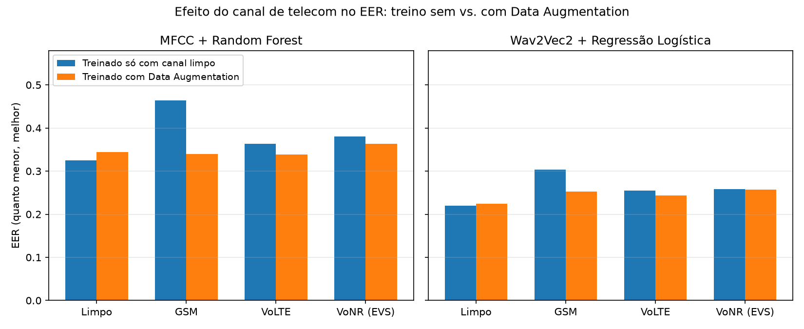
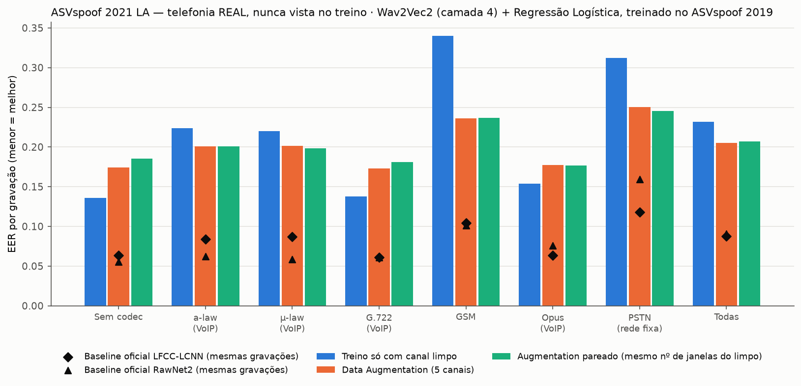
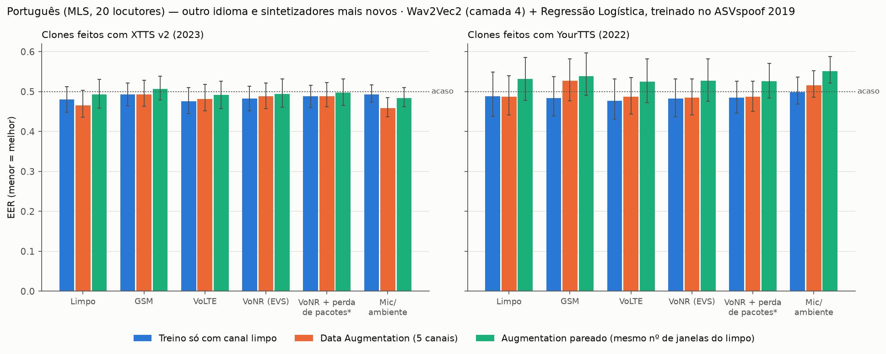
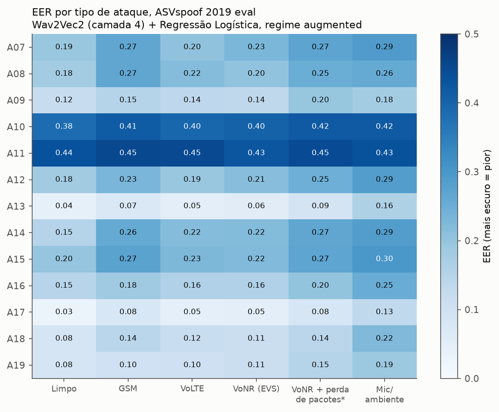
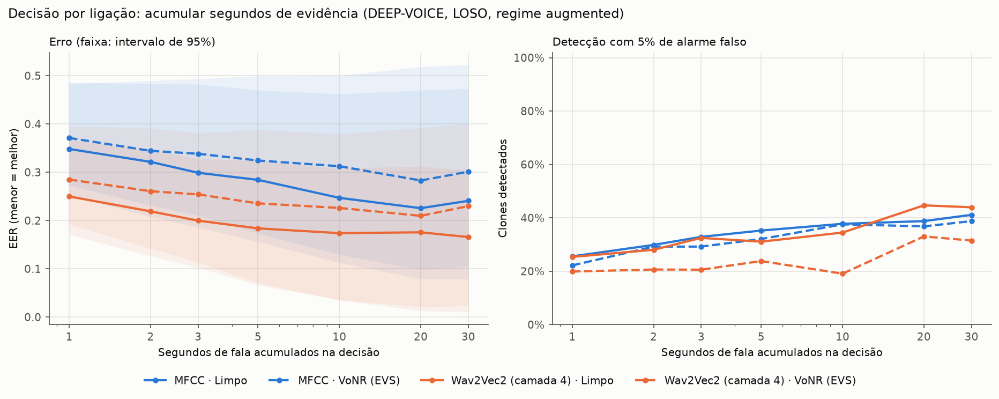
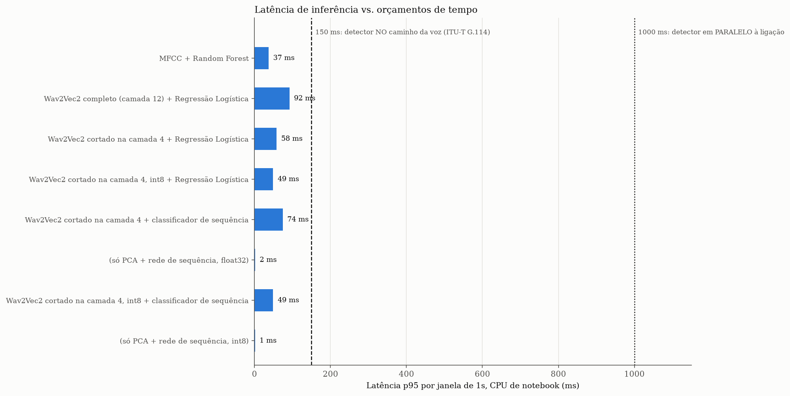
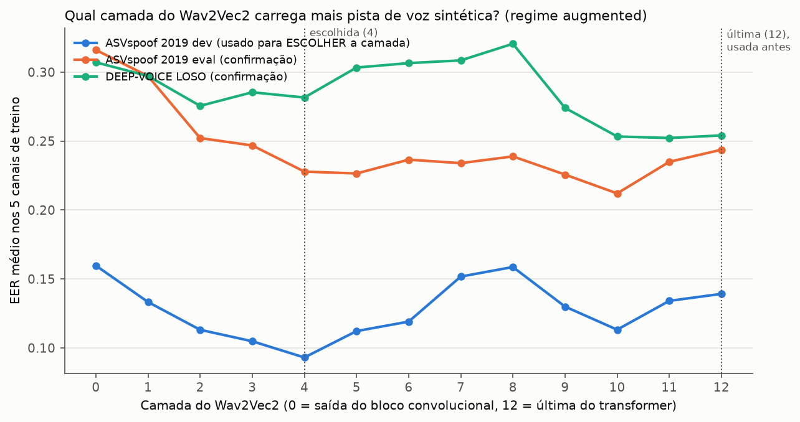
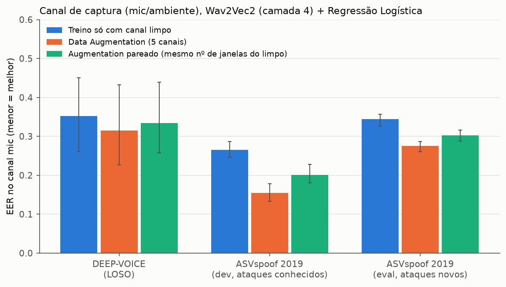
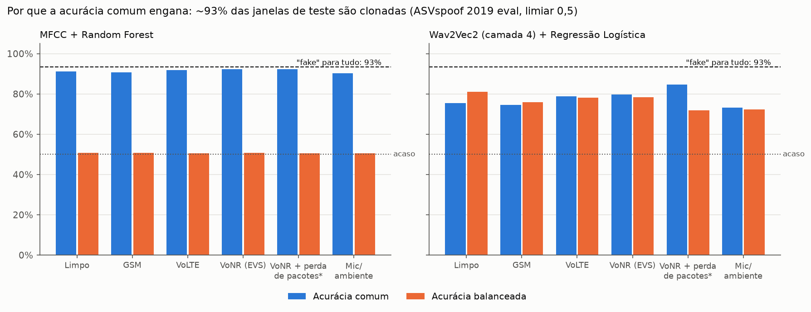
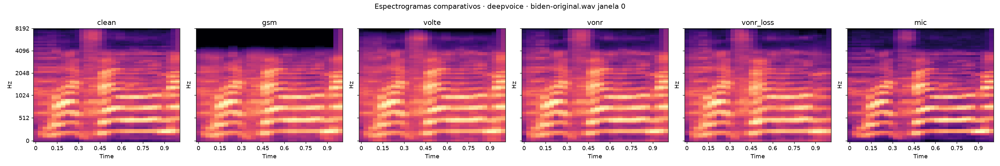

# ANTI-FAKE-VOICE: Detecção de Deepfakes de Voz em Streaming na Borda (MEC) e Robustez ao Codec 5G (VoNR/EVS)

Projeto de pesquisa acadêmica que investiga duas perguntas:

1. **Um classificador de voz clonada erra mais quando o áudio passa por um canal de
   telecom** (GSM, VoLTE, VoNR/5G) — como acontece com ouvintes humanos, segundo um
   artigo de referência?
2. **Data Augmentation resolve isso?** Ou seja: treinar o modelo já expondo-o a esses
   canais distorcidos o torna robusto a eles?

Tudo sob a restrição de latência de um nó MEC (Multi-access Edge Computing): o
detector precisa decidir sobre cada janela de 1 segundo de áudio a tempo de
acompanhar uma ligação ao vivo.

## Como o projeto evoluiu

O projeto cresceu em etapas, e cada uma partiu do que a anterior deixou em aberto:

1. **Canais de telecom num dataset pequeno.** O ponto de partida foi o DEEP-VOICE (6
   locutores) passado por três codecs reais (GSM, VoLTE e VoNR). A comparação era
   entre um modelo treinado só com áudio limpo e um treinado já com os canais (Data
   Augmentation), e a latência das duas arquiteturas era medida contra o orçamento de
   uma ligação ao vivo.
2. **Mais escala, e o mundo fora da simulação.** Para ver se o padrão se sustentava,
   entrou o ASVspoof 2019 (107 locutores, 19 ataques). Em seguida vieram os testes
   com a voz da própria pesquisadora: clonada com XTTS v2, testada ao vivo pelo
   microfone e incluída num retreino. Como o microfone também confundia o detector,
   surgiu um canal de captura (microfone e ambiente). Essa etapa mostrou que o maior
   problema era generalizar para pessoas e gravações novas.
3. **Um método mais rigoroso.** Uma releitura crítica do pipeline trouxe várias
   mudanças:
   - o codec passou a ser aplicado à gravação inteira, como numa ligação contínua,
     em vez de a cada segundo isolado;
   - os resultados ganharam intervalos de confiança por locutor;
   - um controle com o mesmo número de janelas passou a separar "ver canais
     diferentes" de "ter mais dados";
   - o teste de locutor conhecido passou a usar um trecho novo da fala;
   - a camada do Wav2Vec2 passou a ser escolhida num conjunto de validação.
4. **Testes fora do laboratório.** Por último vieram:
   - telefonia real (ASVspoof 2021 LA);
   - outro idioma, com sintetizadores atuais (português);
   - a decisão sobre a ligação inteira, e não só sobre cada segundo;
   - uma versão do Wav2Vec2 cortada e quantizada para caber no orçamento de latência.
5. **Mais dados de treino e um classificador mais forte.** O treino passou a usar o
   split de treino completo do ASVspoof 2019 (25.380 gravações, ~10 vezes a amostra
   usada até então), e entrou um segundo classificador, que lê a sequência de vetores
   do Wav2Vec2 (um a cada 20 ms) em vez da média deles. Com as mesmas gravações, um
   controle passou a medir quanto codificar cada segundo isoladamente, como nas
   primeiras etapas, distorce o efeito estimado de cada canal.

## Principais resultados

- **O canal mais difícil para o classificador é o GSM**, de banda estreita — o
  contrário do que acontece com humanos, que acertam mais no GSM. Com o MFCC,
  enquanto cada segundo era codificado isoladamente, o VoNR (5G) parecia o pior caso;
  com o codec aplicado à ligação inteira, esse padrão desaparece.
- **O jeito de simular o codec pesa mais para classificadores mais ricos.** Num
  controle direto (mesmas gravações e modelos), codificar cada segundo isoladamente
  não muda o classificador de média do Wav2Vec2, mas aumenta em 2,6 pontos o erro do
  classificador de sequência no GSM e no VoNR — quase dobra o efeito estimado do VoNR.
- **Data Augmentation funciona, mas é uma troca.** No ASVspoof 2019, treinar com os
  canais simulados melhora todos os canais degradados (GSM: EER 0,288 → 0,241) e
  piora o áudio limpo (0,162 → 0,193). Com o mesmo número de janelas, o ganho nos
  codecs se mantém: para o classificador de média, **o que ajuda é ver canais
  diferentes, não ter mais dados**. Para o classificador de sequência, o volume
  também conta.
- **Ler a sequência ajuda mais que ter mais dados.** Com o split de treino completo
  do ASVspoof 2019 (10 vezes mais gravações), o classificador de média melhora pouco
  (EER no eval 0,162 → 0,149); o classificador que lê a sequência de vetores do
  Wav2Vec2 chega a 0,116 por janela e 0,097 por gravação, perto dos detectores de
  referência de 2019.
- **O ganho vale em telefonia real.** No ASVspoof 2021 LA, com gravações
  transmitidas de verdade por 7 sistemas de telefonia, o treino com codecs simulados
  reduz o erro de 23,2% para 20,5%, com ganhos maiores no GSM (34,0% → 23,6%) e na
  rede fixa (PSTN, 31,2% → 25,0%). Ele melhora até codecs que nunca foram simulados.
  Com o treino completo e o classificador de sequência, o erro cai de 17,8% para
  16,3% (PSTN: 22,4% → 17,0%), e o treino com canais também mantém o limiar de
  decisão: sem ele, o limiar escolhido no laboratório marca como clonadas 29% das
  gravações reais no GSM; com ele, 8%. Os detectores oficiais do desafio continuam
  melhores (~9%), e quase toda a diferença já aparece sem codec — vem dos ataques
  novos, não do canal.
- **O canal não é o maior problema.** Depois do treino com canais, o efeito do canal
  fica em no máximo ~8 pontos percentuais de EER. Um **locutor nunca visto** custa
  ~15 pontos, e um **tipo de ataque nunca visto** triplica o erro (0,063 → 0,193). Em
  **português, com sintetizadores atuais** (XTTS v2 e YourTTS), nenhum modelo passa
  muito do chute: o melhor erra 36,3% por gravação, e boa parte da voz real é marcada
  como falsa.
- **Acumular evidência ajuda pouco.** Com 10 segundos de ligação e 5% de alarme
  falso, o melhor modelo detecta ~1/3 das ligações clonadas. Juntar segundos cancela
  erros aleatórios, mas não erros sistemáticos.
- **A latência cabe no orçamento.** O Wav2Vec2 cortado na camada 4 e quantizado em 8
  bits decide em 49 ms (p95) por janela de 1 s em CPU de notebook, abaixo dos 150 ms
  de uma conversa (ITU-T G.114). A quantização custa pouco: o EER passa de 0,063 para
  0,068. O classificador de sequência acrescenta só ~1 ms por janela.
- **O MFCC não generaliza.** Ele fica no nível do chute diante de ataques novos e, em
  português, chama de falsas ~99% das janelas, reais ou clonadas.

Os testes ao vivo pelo microfone (Figura 6, Tabela 4) são da etapa 2, antes de o
áudio do microfone receber a mesma normalização de volume do treino. Eles serão
repetidos com o pipeline atual.

## Dados

| Conjunto | Papel | Locutores | Ataques | Canais |
|---|---|---|---|---|
| **DEEP-VOICE** (Kaggle) | treino e teste (Leave-One-Speaker-Out) | 6 | 1 (conversão de voz RVC) | 6 simulados |
| **ASVspoof 2019 LA** | treino / validação / teste | 107 | 19 (A01–A19) | 6 simulados |
| **ASVspoof 2021 LA** (eval) | só teste | 67 | 13 (A07–A19) | 7 reais (transmitidos) |
| **Português** (Multilingual LibriSpeech) | só teste | 20 | 2 (XTTS v2, YourTTS) | 6 simulados |

Os 6 canais simulados são: limpo, GSM (AMR-NB), VoLTE (AMR-WB), VoNR (EVS), VoNR com
perda de pacotes em rajada (só no teste) e microfone/ambiente. Nenhum modelo é
treinado com os dois últimos conjuntos, nem nenhuma escolha é feita com base neles.

## Setup

```bash
python3 -m venv .venv
source .venv/bin/activate
pip install -r requirements.txt
```

O FFmpeg do sistema (via `apt`) **não** vem com os encoders AMR necessários para
simular GSM e VoLTE. É preciso compilar um FFmpeg próprio:

```bash
ffmpeg -encoders | grep -i amr   # tem que listar libopencore_amrnb e libvo_amrwbenc
```

Se faltar, compile com (dependências de build via `apt`, depois `./configure` e
`make`, instalando em `tools/ffmpeg-amr/`):

```bash
--enable-gpl --enable-nonfree --enable-version3 \
--enable-libopencore-amrnb --enable-libvo-amrwbenc
```

Para o canal VoNR (5G), o projeto usa o **codec de referência EVS** (3GPP TS 26.442/
26.443), compilado a partir do código de referência da 3GPP em `tools/evs-src/`
(binários `EVS_cod`/`EVS_dec`). Confira se os dois setups estão prontos com:

```bash
python -m src.channel_sim
```

A clonagem de voz (`clone_voice.py`, `clone_voice_pt.py`) usa o Coqui TTS, que exige
uma versão de `transformers` incompatível com o resto do projeto. Por isso ela roda
num ambiente virtual **separado**:

```bash
python3 -m venv .venv-tts
.venv-tts/bin/pip install torch torchaudio "coqui-tts[codec]"
```

Todo o projeto roda em CPU, sem GPU. O pipeline completo leva pouco mais de um dia
de processamento num notebook. A maior parte desse tempo é a extração de atributos
do Wav2Vec2 e a clonagem com o XTTS v2.

## Onde colocar os dados

```
data/raw/KAGGLE/AUDIO/REAL/, FAKE/          # DEEP-VOICE (Kaggle, Jordan J. Bird)
data/raw/ASVSPOOF2019/LA/                   # ASVspoof 2019 LA, com ASVspoof2019_LA_asv_scores/ (para o min t-DCF)
data/raw/ASVSPOOF2021/ASVspoof2021_LA_eval.tar.gz   # Zenodo, registro 4837263 (7,8 GB; lido sem extrair)
data/raw/ASVSPOOF2021/keys/LA/CM/           # chaves: LA-keys-full.tar.gz (asvspoof.org), extraído em data/raw/ASVSPOOF2021/
data/raw/PT/mls_pt_dev.parquet, mls_pt_test.parquet # MLS português (Hugging Face, facebook/multilingual_librispeech)
```

As chaves do ASVspoof 2021 trazem os metadados de cada gravação (`trial_metadata.txt`)
e as pontuações dos 4 detectores oficiais (`CQCC-GMM/`, `LFCC-GMM/`, `LFCC-LCNN/`,
`RawNet2/`), usadas como comparação. Os arquivos do MLS em português estão em
`https://huggingface.co/datasets/facebook/multilingual_librispeech/resolve/main/portuguese/{dev,test}-00000-of-00001.parquet`.

## Estrutura de pastas

```
data/raw/                     # dados brutos (não versionados)
data/manifest*.csv            # tabelas mestre de janelas, uma por conjunto — geradas por build_dataset*.py
data/features_*               # atributos extraídos — gerados por features.py
src/                          # todo o pipeline, um script por etapa (ver abaixo)
models/                       # modelos treinados (.joblib, não versionados)
results/                      # tabelas-resumo (.csv, versionadas)
results/figures/              # gráficos e tabelas em imagem (versionados)
tools/                        # FFmpeg com AMR e codec de referência EVS, compilados
```

## Passo a passo

Os scripts rodam nesta ordem; cada um lê o que o anterior gerou. Os mais longos
retomam sozinhos se forem interrompidos.

### 1. Montar os conjuntos áudio × canal

```bash
python -m src.build_dataset          --channels clean gsm volte vonr mic vonr_loss
python -m src.build_dataset_asvspoof --channels clean gsm volte vonr mic vonr_loss --cap 20
```

Cada gravação tem o silêncio de borda removido e passa **inteira** pelo canal (como
numa ligação contínua). Só depois ela é fatiada em janelas de 1 s, normalizadas a
-16 LUFS. No ASVspoof, `--cap` limita quantas gravações entram por combinação
locutor × ataque.

### 2. Extrair os atributos

```bash
python -m src.features --kind mfcc     --dataset deepvoice
python -m src.features --kind mfcc     --dataset asvspoof
python -m src.features --kind wav2vec2 --dataset deepvoice   # guarda as 13 camadas
python -m src.features --kind wav2vec2 --dataset asvspoof
```

### 3. Escolher a camada do Wav2Vec2

```bash
python -m src.layer_sweep
```

Treina o mesmo classificador com cada uma das 13 camadas e mede o EER. A escolha usa
**só** o dev do ASVspoof 2019, e deu a camada 4. A camada escolhida é fixada à mão em
`W2V_LAYER`, em `src/features.py`. O resultado fica em `results/layer_sweep.csv`.

### 4. Treinar e avaliar

```bash
python -m src.train    --dataset deepvoice --save-final
python -m src.evaluate --dataset deepvoice
python -m src.train    --dataset asvspoof  --save-final
python -m src.evaluate --dataset asvspoof
# modelos da camada 12 (a última da rede, usada nas primeiras etapas), para comparação nos testes externos:
python -m src.train --dataset deepvoice --features wav2vec2 --layer 12 --final-only
python -m src.train --dataset asvspoof  --features wav2vec2 --layer 12 --final-only
```

Treina MFCC + Random Forest e Wav2Vec2 + Regressão Logística em 3 regimes:

- **limpo**: só áudio limpo;
- **augmentado**: 5 canais;
- **pareado**: 5 canais, mas com o mesmo número de janelas do limpo.

No DEEP-VOICE, a avaliação é por Leave-One-Speaker-Out: cada locutor é testado num
modelo que nunca o ouviu. No ASVspoof, o modelo treina no split de treino e é testado
no dev e no eval, que têm locutores e ataques novos. As métricas são EER com intervalo
de 95% por bootstrap agrupado por locutor, acurácia balanceada e, no ASVspoof, min
t-DCF e EER por tipo de ataque.

### 5. Análises complementares

```bash
python -m src.call_level              # decisão por ligação: erro com 1 a 30 s de evidência
python -m src.speaker_dependent_eval  # locutor conhecido (trecho novo da mesma gravação) vs. desconhecido
python -m src.plot_metrics --dataset deepvoice   # curva DET, t-SNE, espectrogramas
python -m src.plot_metrics --dataset asvspoof
python -m src.latency_bench           # latência por janela vs. orçamentos de tempo real
python -m src.audit_silence           # confere se real e clonada diferem no silêncio de borda
```

### 6. Testes externos (sem retreino)

**ASVspoof 2021 LA — telefonia real.** O pacote é lido em sequência, sem ser
extraído, e vira atributos direto:

```bash
python -m src.build_dataset_asvspoof2021
python -m src.external_eval --test-datasets asvspoof2021
```

**Português — outro idioma, sintetizadores atuais.** São três etapas, porque a
clonagem roda no ambiente do TTS:

```bash
python -m src.build_dataset_pt prepare                          # áudio real + lista de frases a clonar
COQUI_TOS_AGREED=1 .venv-tts/bin/python src/clone_voice_pt.py   # XTTS v2 e YourTTS
python -m src.build_dataset_pt build                            # janelas em todos os canais
python -m src.features --kind mfcc     --dataset pt
python -m src.features --kind wav2vec2 --dataset pt --layers 4 12
python -m src.external_eval --test-datasets pt
```

Cada locutor é clonado a partir de uma gravação de referência que fica fora do teste.
Os dois sintetizadores falam as mesmas frases. As vozes clonadas passam por Opus,
como as reais do MLS, para que a compressão não denuncie a classe.

### 7. Testes com a própria voz

```bash
.venv-tts/bin/python src/clone_voice.py           # clona a sua voz (XTTS v2)
python -m src.own_voice_pretrain_test --dataset deepvoice   # sua voz contra os modelos originais
python -m src.own_voice_pretrain_test --dataset asvspoof
python -m src.own_voice_ceiling                   # retreina incluindo a sua voz e testa num trecho que ficou de fora
python -m src.live_demo --seconds 15 --features wav2vec2 --dataset asvspoof   # ao vivo, pelo microfone
```

Requer `data/my_voice_reference.wav`: grave ~15 s da **sua própria voz**, falando
naturalmente. O arquivo não é fornecido no repositório — cada pessoa grava e usa a
própria voz, e o `.gitignore` impede que ele seja versionado. Ao usar o XTTS v2, você
concorda com a licença CPML da Coqui (uso não comercial). Para gravar (16 kHz, mono):

```bash
arecord -d 15 -f S16_LE -r 16000 -c 1 data/my_voice_reference.wav
```

Com uma sessão só, o retreino testa no trecho final da mesma gravação, o que deixa
poucas janelas de teste. Para um teste de verdade, grave outras sessões em outro dia,
de preferência com outro microfone: `data/my_voice_reference_2.wav`, `_3.wav`… O
`clone_voice.py` clona cada sessão (pulando as já clonadas), e o `own_voice_ceiling`
passa a treinar nas primeiras sessões e testar na última.

O `live_demo` grava janelas de 1 s via `arecord` (ALSA) e mostra a probabilidade de
cada uma ser clonada. Use `--int8` para o Wav2Vec2 quantizado, ou `--model` para um
modelo específico (por exemplo, `models/wav2vec2_with_own_voice.joblib`). **Rode-o no
seu próprio terminal**, porque ele espera sua fala em tempo real.

### 8. Treino completo e classificador de sequência

```bash
python -m src.build_dataset_asvspoof_full fit-pca   # PCA dos vetores por quadro (768 -> 128), com janelas da amostra
python -m src.build_dataset_asvspoof_full build     # treino completo, 5 canais (retoma se interrompido)
python -m src.build_dataset_asvspoof_full dev       # dev, para escolher a época da rede
python -m src.build_dataset_asvspoof_full check     # confere contra os atributos da amostra
python -m src.sequence_classifier                   # média + RL e classificador de sequência, 3 regimes
python -m src.full_predict --source asvspoof        # dev e eval do 2019, 6 canais
python -m src.full_predict --source perwindow       # controle: codec em cada janela de 1 s isolada
python -m src.full_predict --source pt              # português (precisa das janelas do passo 6)
python -m src.full_predict --source asvspoof2021    # telefonia real, lida direto do pacote
python -m src.full_tables                           # tabelas results/full_*.csv
python -m src.paper_figures                         # figuras do artigo de congresso
```

Para não ocupar ~7 GB com janelas em disco, cada gravação do treino completo é
preparada em memória (mesmo corte de silêncio, mesmo codec na gravação inteira,
mesma normalização) e só os atributos vão para o disco: a média dos vetores da
camada 4 e a sequência deles projetada em 128 dimensões. O `check` confirma que o
resultado é idêntico ao do pipeline em disco. Os testes também passam pela rede numa
passada só, guardando só as predições de cada modelo.

O classificador de sequência é uma rede pequena (~230 mil parâmetros) que roda em
CPU: duas convoluções no tempo, um *pooling* de estatísticas com atenção e a média
completa dos 768 valores. A época final é a de menor EER no dev.

### 9. Gráficos e tabelas

```bash
python -m src.make_diagram   # desenho do experimento
python -m src.make_figures   # figuras 1–13
python -m src.make_tables    # tabelas 1–8, como imagem
```

## Resultados

### Tabelas em `results/`

| Arquivo | O que mostra |
|---|---|
| `channel_model_table.csv` | DEEP-VOICE: EER [IC 95%], acurácia balanceada e F1 por canal × atributo × regime |
| `channel_model_table_asvspoof.csv` | ASVspoof 2019, dev e eval: o mesmo, mais EER por gravação e min t-DCF |
| `attack_table_asvspoof.csv` | EER por tipo de ataque no ASVspoof 2019 |
| `speaker_table.csv` | EER por locutor deixado de fora (DEEP-VOICE) |
| `layer_sweep.csv` | EER por camada do Wav2Vec2 |
| `call_level_table.csv` | Decisão por ligação: EER e detecção com 5% de alarme falso, por segundos de evidência |
| `speaker_dependent_table.csv` | Locutor conhecido, testado num trecho novo da fala |
| `latency.csv`, `latency_quality.csv` | Latência de cada arquitetura; perda de qualidade da versão de 8 bits |
| `external_eval_table.csv` | Testes externos (ASVspoof 2021 e português), por condição e por sintetizador |
| `asvspoof2021_baselines.csv` | EER dos 4 detectores oficiais do ASVspoof 2021, nas mesmas gravações |
| `call_level_pt.csv` | Decisão por ligação no conjunto em português |
| `own_voice_pretrain_table*.csv`, `own_voice_ceiling_table.csv` | Voz própria, antes e depois do retreino |
| `silence_audit_*.csv` | Auditoria de silêncio de borda (real vs. clonada) |
| `full_train_log.csv` | Treino completo: EER no dev de cada época, por classificador e regime |
| `full_asvspoof2019.csv` | Treino completo: ASVspoof 2019 dev e eval por canal, para a amostra e o split completo, média + RL e sequência |
| `full_perwindow.csv` | Codec na gravação inteira vs. em cada janela isolada, mesmos modelos e gravações |
| `full_perwindow_paired.csv` | A diferença de EER entre os dois modos de simular, janela a janela, com intervalo pareado |
| `full_asvspoof2021.csv`, `full_pt.csv` | Treino completo: testes externos por condição e por sintetizador, com alarme falso e detecção no limiar do dev |

As predições janela a janela (`cv_predictions*.csv`) não são versionadas por serem
grandes; o passo 4 as regenera.

### Gráficos

**Desenho do experimento**


**Efeito do canal, com e sem Data Augmentation:** o GSM é o canal mais difícil, e o
treino com canais melhora os degradados à custa do limpo.



**Telefonia real (ASVspoof 2021 LA):** a banda estreita é o que mais atrapalha, e o
treino com codecs simulados ajuda nela.



**Português, com sintetizadores atuais:** todos os modelos ficam perto do chute.



**Ataques nunca vistos (ASVspoof 2019 eval):** o erro muda muito de um ataque para
outro.



**Locutor conhecido vs. desconhecido**


**Decisão por ligação:** o erro cai com mais segundos de evidência, mas para de
melhorar depois de ~10 s.



**Latência vs. orçamentos de tempo real**



**Camada do Wav2Vec2:** a melhor camada depende do dataset.



**Canal de captura (microfone):** o ganho do treino com canais é maior no ASVspoof.



**Voz própria: antes e depois do retreino**


**Por que a acurácia comum engana** com classes desbalanceadas, e por que o projeto
usa EER e acurácia balanceada.



**Nenhum atributo MFCC isolado separa bem voz real de clonada**


**Teste ao vivo com dois microfones** (etapa 2 do projeto; será repetido com o pipeline atual)


Gerados por [`src/plot_metrics.py`](src/plot_metrics.py), em
`results/figures/deepvoice/` e `results/figures/asvspoof/`:

**t-SNE dos atributos MFCC — colorido por canal (esq.) e por locutor (dir.)**


O GSM forma um grupo isolado: o MFCC organiza parte do seu espaço em torno do canal,
um risco de atalho. Colorir por locutor não forma grupo nenhum.

**Curva DET por canal (Wav2Vec2, DEEP-VOICE)**


**Espectrogramas comparativos entre canais**



### Tabelas em imagem

[`src/make_tables.py`](src/make_tables.py) gera as 8 tabelas do artigo como imagem
(estilo acadêmico, só regras horizontais), em `results/figures/tabela1_*.png` a
`tabela8_*.png`:

1. os quatro conjuntos de dados;
2. EER principal;
3. ASVspoof por canal, com min t-DCF;
4. teste ao vivo;
5. ASVspoof 2021;
6. português;
7. latência;
8. decisão por ligação.

## Referências

Os artigos que embasam o projeto são:

- **Human Detection of Voice-Cloned Speech Under GSM, VoLTE** — inspirou a premissa
  central do projeto (codecs de telecom prejudicam a detecção de voz clonada) e a
  metodologia de simular os canais via FFmpeg.
- **Multi-Granularity Adaptive Time-Frequency Attention Framework for Audio** — aborda
  detecção de deepfake sob degradações do mundo real (compressão por codec, perda de
  pacotes), base para justificar por que Data Augmentation com canal simulado ajuda.
- **RTCFake: Speech Deepfake Detection in Real-Time Communication** — foca na ameaça em
  cenários de comunicação em tempo real, justificando o recorte do projeto para RTC ao
  vivo (e não só análise offline).
- **Defense Against Synthetic Speech in Real-Time** — origem da arquitetura de
  classificação em streaming (janelas de 1s, modelos leves de baixa latência) e valida
  o uso do dataset DEEP-VOICE.
- **Privacy-Aware AI for Multimedia Streams** — referência para a arquitetura de IA
  compatível com borda (edge), justificando rodar a detecção num nó MEC da operadora.
- **ASVspoof 2019 e 2021 LA** — os datasets de treino/teste com split oficial e o teste
  em telefonia real, com os detectores oficiais como comparação.
- **Multilingual LibriSpeech, XTTS v2 e YourTTS** — as vozes reais e os dois
  sintetizadores do conjunto em português.
